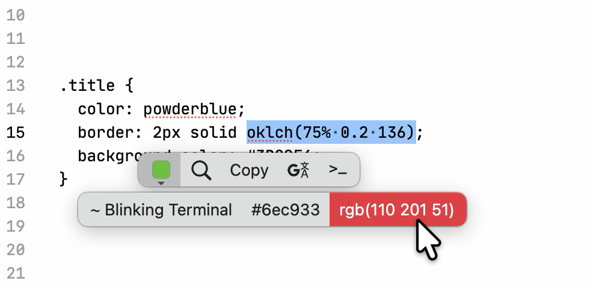
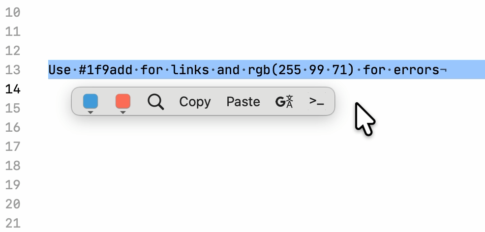
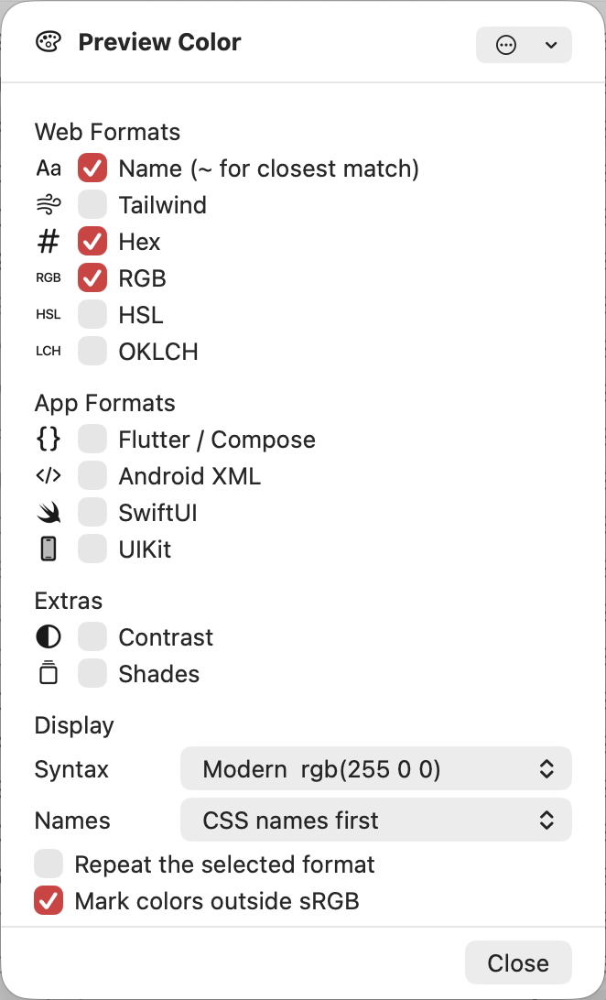

# Preview Color

Preview the selected color, and copy it in other formats.

Select a color and PopClip shows a swatch of it, with its closest name as the tooltip. Hover the swatch for a row of buttons: click one to copy that value, or Option-click (⌥) to replace the color in place.

Examples:

- `#1f9add` → swatch named `~ Homeworld`, with buttons `~ Homeworld` and `rgb(31 154 221)`
- `rgb(255, 0, 0)` → `red`, `#ff0000`
- `bg-sky-500` → `~ Fresh Blue of Bel Air`, `#00a6f4`, `rgb(0 166 244)`, `outside sRGB` (Tailwind's palette goes beyond sRGB)
- `Color(0xFF1F9ADD)` → `~ Homeworld`, `#1f9add`, `rgb(31 154 221)`
- `oklch(75% 0.2 136)` → `~ Blinking Terminal`, `#6ec933`, `rgb(110 201 51)`
- `oklch(60% 0.2 250)` → the closest sRGB color, marked `outside sRGB`

The format you selected is left out of the buttons, since you already have it.

It recognizes:

- CSS colors: names, `#hex`, `rgb()`, `hsl()`, `hwb()`, `lab()`, `lch()`, `oklab()`, `oklch()` and `color()`, with an optional trailing `;` or a missing `)`
- Hex without `#`, like `1f9add`
- Platform code: Flutter / Compose `Color(0xFF1F9ADD)` and `Color.fromARGB(…)`, Android `Color.rgb(…)`, SwiftUI `Color(red:green:blue:)`, UIKit / AppKit `UIColor(red:green:blue:alpha:)` and `#colorLiteral(…)`
- Tailwind: `sky-500`, utility classes like `hover:bg-sky-500/50` or `bg-[#1f9add]`, and `var(--color-sky-500)`
- Colors inside longer text, like `rgb(31 154 221)` in a sentence, with one swatch per color

## Options

- **Web Formats**: buttons for the closest name, the nearest Tailwind color, hex, RGB, HSL and OKLCH.
- **App Formats**: buttons for Flutter / Compose `Color(0xFF1F9ADD)`, Android XML `#1F9ADD`, SwiftUI and UIKit. Colors outside sRGB but inside Display P3 use the P3 initializers.
- **Extras**: **Contrast** shows the WCAG ratio against white and black, like `white 3.1 AA large, black 6.7 AA`. **Shades** opens ten swatches of the same hue, from light to dark.
- **Syntax**: modern `rgb(255 0 0)` or comma `rgb(255, 0, 0)`.
- **Names**: use the CSS name, like `azure`, when the color matches one exactly, or always use the color list.
- **Repeat the selected format**: also show a button for the format you selected.
- **Mark colors outside sRGB**: add an `outside sRGB` button when the swatch can only show the closest color.
- **Find in text**: how many colors to find inside longer text, from `Exact match only` to `6 colors`.
- **Recognize**: CSS declarations like `color: red;`, hex without `#`, bare `0, 128, 255`, platform code and Tailwind classes can each be turned on or off.

## Notes

Author: Heysem Katibi

Preview Color works entirely on your Mac. It has no network access and sends no data anywhere.

Color names come from the [color-name-list](https://github.com/meodai/color-names) "best of" list (MIT, Copyright (c) 2017 David Aerne). The Tailwind palette comes from [tailwindcss](https://github.com/tailwindlabs/tailwindcss) 4.3.3 (MIT, Copyright (c) Tailwind Labs, Inc.). Color conversion and gamut mapping follow the [CSS Color 4](https://www.w3.org/TR/css-color-4/) sample code.

Requires PopClip 2026.8.

## Changelog

- 25 Oct 2026: Initial release
